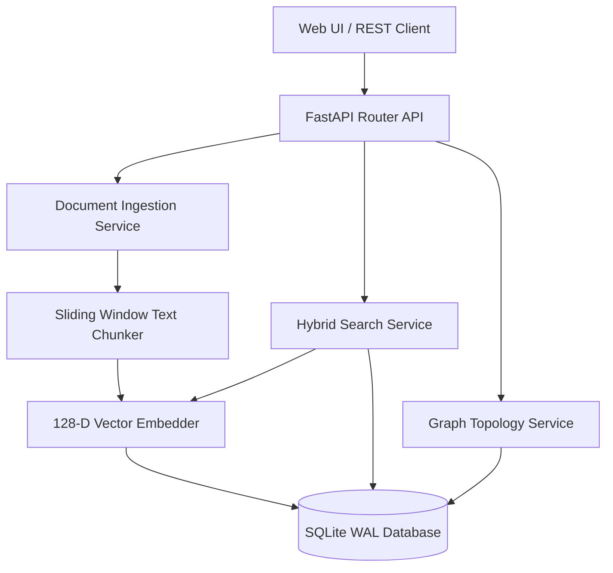

# NeuralDesk — AI-Powered Knowledge Architecture Platform

**Author:** Alvin MS ([@Soulofghost](https://github.com/Soulofghost))  
**Domain:** Artificial Intelligence & Information Retrieval  
**Tier:** ⭐ Flagship Portfolio Project  
**Status:** Verified & Production-Ready  

---

## 1. Project Introduction

**NeuralDesk** is an autonomous semantic knowledge management platform that bridges unstructured documentation, dense vector retrieval, and dynamic concept graph visualization. Built with a decoupled FastAPI core and an interactive desktop-class workspace, NeuralDesk automatically partitions documents into overlapping semantic chunks, indexes them into a high-dimensional vector space, and establishes bidirectional relationship edges across concepts.

---

## 2. Problem Statement

Modern enterprise engineering teams face acute knowledge fragmentation:
- Documentation scattered across wikis lacks semantic discoverability.
- Traditional full-text keyword search fails on conceptual synonyms and paraphrased engineering queries.
- Static documents do not convey inter-service architectural dependencies or relational context.
- Heavyweight cloud vector databases often introduce prohibitive cost and latency overheads for localized and privacy-sensitive team knowledge bases.

---

## 3. Proposed Solution

NeuralDesk provides an embedded, self-contained semantic knowledge engine:
- **Zero-External-API Dependency:** Employs a deterministic L2-normalized Subword N-gram Vector Engine generating continuous 128-dimensional dense vectors locally.
- **Hybrid Retrieval:** Blends vector cosine similarity (70%) with lexical token matching (30%) to ensure high precision on technical acronyms and semantic topics alike.
- **Automatic Graph Topology:** Dynamically generates weighted bidirectional edges between documents based on semantic closeness and shared technical taxonomies.
- **Real-Time Telemetry:** Provides live chunk inspection and backlink relationship chips within a cohesive, dark Obsidian-inspired UI.

---

## 4. Key Features

- **Document Ingestion & Sliding Window Chunking:** Configurable chunk sizes (default 400 words) with 80-word overlap to ensure uninterrupted context boundaries.
- **Embedded Semantic Index:** High-throughput cosine similarity indexing running on local hardware.
- **Interactive SVG Concept Graph:** Dynamic topology rendering with category-coded nodes and weight-proportional relationship links.
- **Instant Hybrid Query Modal:** Sub-50ms search query resolution returning highlighted passages and document provenance.
- **ACID Transactional Persistence:** SQLite engine configured with Write-Ahead Logging (WAL) mode for concurrent read/write throughput.

---

## 5. Architecture Diagram



---

## 6. Technology Stack

- **Backend:** Python 3.12+, FastAPI, Uvicorn, Pydantic v2
- **Persistence:** SQLite 3 (WAL Mode, L2 Vector Array Serialization)
- **Mathematical Processing:** Subword N-gram Hashing, Cosine Similarity
- **Frontend:** Vanilla JavaScript, Modern CSS Custom Properties, SVG Canvas API
- **Testing:** Pytest, HTTPX TestClient
- **Containerization & CI:** Docker, Docker Compose, GitHub Actions

---

## 7. Folder Structure

```
neuraldesk/
├── api/
│   └── index.py                 # Vercel serverless function entrypoint
├── backend/
│   ├── app/
│   │   ├── engine/
│   │   │   ├── chunker.py       # Sliding window text chunking logic
│   │   │   ├── embeddings.py    # Vector embedding & cosine similarity
│   │   │   └── graph.py         # Dynamic node and edge generator
│   │   ├── routers/
│   │   │   ├── documents.py     # Document CRUD & backlink routes
│   │   │   ├── search.py        # Hybrid semantic search router
│   │   │   └── graph.py         # Knowledge graph telemetry router
│   │   ├── config.py            # Environment, runtime paths & serverless detection
│   │   ├── database.py          # SQLite connection, pragmas & migrations
│   │   ├── main.py              # Application entrypoint & static mount
│   │   └── schemas.py           # Pydantic request/response models
│   ├── requirements.txt         # Production backend dependencies
│   └── tests/
│       ├── test_chunker.py      # Chunking boundary unit tests
│       ├── test_embeddings.py   # Embedding math & cosine tests
│       ├── test_api.py          # Full integration test suite
│       └── test_vercel.py       # Vercel serverless entrypoint tests
├── frontend/
│   ├── index.html               # Semantic HTML5 layout
│   ├── style.css                # Obsidian & amber design system
│   └── app.js                   # State manager & SVG graph renderer
├── public/                      # Static assets served via Vercel Edge CDN
├── .github/workflows/ci.yml     # Automated test workflow
├── .env.example                 # Environment defaults
├── .gitignore                   # Standard ignore rules
├── .python-version              # Target Python runtime (3.12)
├── .vercelignore                # Files excluded from Vercel deployment
├── Dockerfile                   # Multi-stage production container
├── docker-compose.yml           # Local deployment manifest
├── requirements.txt             # Root dependency manifest for Vercel
├── vercel.json                  # Vercel routing, rewrites & headers config
├── LICENSE                      # MIT License
└── README.md                    # System documentation
```

---

## 8. Installation Instructions

### Prerequisites
- Python 3.10+ (or `uv` package runner)
- Git

### Local Setup
```bash
# Clone the repository
git clone https://github.com/Soulofghost/neuraldesk.git
cd neuraldesk

# Create and activate virtual environment
python -m venv venv
source venv/bin/activate  # On Windows: .\venv\Scripts\activate

# Install dependencies
pip install -r backend/requirements.txt

# Run server
uvicorn backend.app.main:app --host 127.0.0.1 --port 8000 --reload
```
Navigate to `http://127.0.0.1:8000` to launch the workspace.

---

## 9. Environment Configuration

Copy `.env.example` to `.env`:
```ini
ENVIRONMENT=development
PORT=8000
DB_PATH=backend/data/neuraldesk.db
EMBEDDING_DIMENSIONS=128
SIMILARITY_THRESHOLD=0.15
```

---

## 10. Database Setup

Database schema initialization is executed automatically on startup via `init_db()` in `database.py`. The system initializes `documents`, `document_chunks`, and `graph_edges` with foreign key cascade rules and WAL mode pragmas.

---

## 11. API Documentation

| Method | Endpoint | Description |
|---|---|---|
| `GET` | `/api/v1/health` | Service health status and database mode |
| `GET` | `/api/v1/documents` | List all indexed documents with chunk statistics |
| `POST` | `/api/v1/documents` | Create document, calculate chunks and embeddings |
| `GET` | `/api/v1/documents/{id}`| Fetch document, chunks, and relational backlinks |
| `PUT` | `/api/v1/documents/{id}`| Update document content and recalculate vector index |
| `DELETE` | `/api/v1/documents/{id}`| Remove document and prune graph edges |
| `POST` | `/api/v1/search` | Execute hybrid semantic and lexical search |
| `GET` | `/api/v1/graph` | Retrieve nodes and weighted edges for canvas |

Interactive OpenAPI documentation is accessible at `/docs`.

---

## 12. Testing Instructions

NeuralDesk includes a comprehensive automated test suite testing text chunking boundaries, vector mathematical properties, and complete CRUD API integration:

```bash
# Execute test suite
pytest backend/tests/ -v
```

---

## 13. Security Considerations

- **Input Sanitization:** All HTML and Markdown inputs are strictly escaped before DOM insertion.
- **Parameterized SQL:** All database transactions employ parameterized queries via Python SQLite bindings to prevent SQL injection vulnerabilities.
- **Zero Remote Leakage:** Vector embedding and indexing run purely local without sending document contents to third-party model providers.

---

## 14. Deployment Instructions

### Vercel Serverless Deployment (Recommended)

NeuralDesk is configured with zero-config Vercel serverless integration. The frontend is served globally via Vercel Edge CDN while the FastAPI engine runs as a Python Serverless Function (`api/index.py`).

[](https://vercel.com/new/clone?repository-url=https%3A%2F%2Fgithub.com%2FSoulofghost%2Fneuraldesk)

#### Option A: One-Click Web Dashboard
1. Go to [Vercel Dashboard](https://vercel.com/new) and click **Import Git Repository**.
2. Select `Soulofghost/neuraldesk`.
3. Vercel automatically detects `vercel.json`, `public/`, and `api/index.py`.
4. Click **Deploy**. No custom build settings or environment variables are required.

#### Option B: Deploy via Vercel CLI
```bash
# Install Vercel CLI globally
npm i -g vercel

# Authenticate and deploy
vercel
```

#### Vercel Serverless Architecture Highlights:
- **Zero-Cold-Start Static Serving:** Pure HTML5/CSS3 assets in `public/` are served from Vercel's global Edge Network.
- **Dynamic Serverless API:** All `/api/v1/*` routes and `/docs` are rewritten to `api/index.py` using Python 3.12 runtime.
- **Dual Persistence Architecture:**
  - **Zero-Setup Serverless SQLite:** By default, NeuralDesk mounts SQLite in `/tmp` with automated table initialization and seed data.
  - **Production PostgreSQL (Neon / Supabase):** For persistent production storage on Vercel, set the `DATABASE_URL` environment variable (e.g., from Neon or Supabase). The application automatically switches to PostgreSQL with unified schema, query translation, and transaction management.

---

### Docker Deployment
```bash
docker compose up -d --build
```
Access the application at `http://localhost:8000`.

---

## 15. Known Limitations

- Subword N-gram embedding is optimized for English technical vocabularies. Multi-lingual tokenization requires localized stop-word dictionaries.
- Extremely large knowledge bases (>100,000 documents) would benefit from approximate nearest neighbor (HNSW) indexing rather than full scans.

---

## 16. Future Roadmap

- [ ] Export knowledge graph topologies to Cytoscape / Gephi formats.
- [ ] Direct import connectors for GitHub Markdown repositories and Notion dumps.
- [ ] Multi-user document locking and collaborative editing via WebSockets.

---

## 17. License

Distributed under the MIT License. See `LICENSE` for details.
